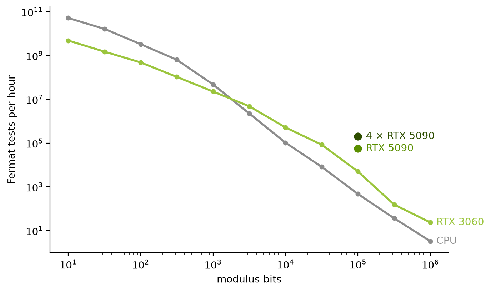

# MontMul

MontMul computes `x ← x² · c mod N` and `a · b mod N` for many independent odd moduli N at once. This modular squaring is the inner step of a Fermat probable-prime test `3^(N−1) mod N`, which runs one step per bit of N.



## Results

Efficiency at 100,000-bit moduli, base 3, best slot count per device; the CPU is an Apple M5.

| configuration | slots | modular squarings/s | Fermat tests/hour | GMP CPU cores equivalent |
|-|-|-|-|-|
| 4 × RTX 5090 (`Multi<Gpu>`) | 1,360 | 5,554,081 | 199,947 | 1,505 |
| RTX 5090 (`Gpu`) | 170 | 1,536,441 | 55,312 | 416 |
| RTX 3060 (`Gpu`) | 448 | 141,550 | 5,096 | 38 |
| CPU, all cores (`Gmp`) | 20 | 20,968 | 755 | 5.7 |

Throughput grows linearly with the GPU count: on one host with four 5090s capped at 420 W, 2, 3 and 4 GPUs run at 2.02, 3.04 and 4.03 times the single-GPU rate of that host (mean of two runs). The single 5090 row comes from a different host at the stock power limit. The CPU row was measured with other applications running (load average about 9).

**Efficiency score.** The score is the median, over 5 repeats, of modular squarings per second on a fixed workload: random 100,000-bit odd moduli (L = 8,192, seed 2026), base 3, and an exponent of the top 2,000 bits of N − 1 in every slot, after a 64-step warm-up. Without `--slots`, the slot count is the best of the logical core count × {1, 2} on the CPU, or the SM count over all GPUs × {1, 2, 4, 8, 16} that fit in device memory. Slot 0, the last slot and two seeded random slots must match `pow_mod`, or no score is reported. Alongside it come the median absolute deviation (MAD), Fermat tests per hour at 100,000 bits, and the equivalent count of CPU cores running `Gmp` (2.709 · 10⁻⁴ s per squaring for one slot on one core). A change is accepted only if its median beats the previous one by at least 2 % and by more than twice the larger MAD.

## Library usage

```rust
use montmul::{Gmp, ModBatch, fermat};
use rug::Integer;

fn main() -> anyhow::Result<()> {
    let moduli = [Integer::from(1_000_003), Integer::from(1_000_005)];

    // Fermat base-3 PRP test of every modulus.
    let prp = fermat(Gmp::default(), &moduli, 3, 1 << 16)?;
    assert_eq!(prp, [true, false]);

    // 3^e mod N slot by slot: load 1, then run the exponent bits.
    let mut batch = ModBatch::new(Gmp::default(), &moduli, 3)?;
    let e = Integer::from(12_345);
    for i in 0..batch.slots() {
        batch.load(i, &Integer::from(1));
        batch.set_exponent(i, &e);
    }
    batch.run(e.significant_bits() as usize);
    for i in 0..batch.slots() {
        assert_eq!(batch.read(i), Integer::from(3).pow_mod(&e, batch.modulus(i)).unwrap());
    }
    Ok(())
}
```

Swap `Gmp::default()` for `Cpu::default()` or `Gpu::new()?` (feature `gpu`) to change backend, or for `Multi::new(Gpu::all()?)` to use every visible GPU. Slots hold values in Montgomery form; `load` and `read` convert on the host. `mul(out, a, b)` multiplies two slots that share a modulus, and `is_one(i)` checks the PRP result without leaving Montgomery form.

## CLI

```
montmul bench --backend cpu|gpu|gmp --bits B --slots S --steps K [--bare] [--csv PATH]
montmul prp   --index N --backend cpu|gpu|gmp
montmul score --backend cpu|gpu|gmp [--slots S] [--label TEXT] [--ncu] [--csv PATH]
```

`bench` times `K` steps on `S` random `B`-bit moduli after a 16-step warm-up and prints one `key=value` line (µs per slot-step, bit-steps per second); `--csv` appends the same fields to a file. `--bare` (GPU only) times the squaring alone, without the reduction. `prp` runs a Fermat base-3 test on the tribonacci number T(N). `score` measures the efficiency score above and prints it, and `--csv` appends it to a file; on the GPU it also reports the reduction overhead (time of a full step over a bare one), and `--ncu` adds Nsight Compute SM and memory throughput. The `gpu` backend uses every visible device (`CUDA_VISIBLE_DEVICES` selects them); `--bare`, the reduction overhead and `--ncu` use device 0.

## How it works

N has no special form, so every step uses Montgomery reduction. Each product is an exact convolution through an M31 × M61 number-theoretic transform over GF(p²) (a right-angle convolution), and the reduction applies the wraparound correction, which halves the transform length of the last product.

The Rust crate lives in `montmul/` and has three backends behind one host API, `ModBatch`:

| backend | what it is |
|-|-|
| `Gpu` | CUDA kernels written in Rust (`montmul/kernels/`), compiled to PTX by NVIDIA's cuda-oxide and launched through cudarc |
| `Cpu` | the same NTT in plain Rust, threaded over slots; the semantics authority that the GPU must match bit for bit |
| `Gmp` | the Montgomery step on `rug` integers, with no transform |

**Parameter rules.** A b-bit modulus takes k = ⌈(b + 4)/32⌉ limbs of 32 bits and the smallest transform length L ≥ 2k, and all moduli in a batch must share L. The wraparound correction needs k = L/2, so the GPU (on by default) and `Cpu::with_wraparound(true)` widen k to that. Registration fails unless c · k · (2^32 − 1)² < Q, where Q ≈ 2^92 is the product of the transform moduli. Inputs and outputs stay in the lazy range [0, 2N), which holds when R ≥ 4cN. The rule k · 32 ≥ b + 4 gives R ≥ 16N, so the base c is at most 4.

**GPU execution model.** One thread block owns one slot and runs whole steps, reading its exponent bits on the device. In shared mode the full transform vector (24 bytes per complex element) sits in shared memory. Larger vectors run in global mode, where each transform runs its first stages in global memory and the rest on tiles of up to 2,048 elements copied into shared memory, one global round trip per tile instead of one per radix-4 pass. `run` splits work into launches of about `GpuOptions::max_launch_ms` (200 ms by default), sized from the measured time per slot-step of the previous launch, so a display watchdog never fires.

**Multiple GPUs.** `Multi` splits a batch's slots into contiguous shards of near-equal size, one per inner backend, and runs each shard on its own host thread. A `mul` whose slots lie in different shards runs on the host with `rug`.

**Known limitations.**

- Transform lengths are powers of two only (2^3 to 2^24).
- Both GPUs allow at most 101,376 B of dynamic shared memory per block, so L ≥ 16,384 runs in global mode.
- One step of one slot is never split across launches, so a single launch can exceed 200 ms at L ≥ 2^21.

## Building and testing

From crates.io, `cargo add montmul` adds the CPU backends and `cargo add montmul --features gpu` the GPU ones. In a checkout, all commands run in `montmul/`. Without a GPU (macOS or Linux), the crate builds on stable Rust 1.88 or later with `cargo build --release`. The GPU build (`cargo build --release --features gpu`) needs Linux, a driver of version 580 or later and CUDA 13; rebuilding the kernels in a checkout also needs LLVM 21, Rust 1.99.1 and `cargo-oxide`.

| hardware | backend |
|-|-|
| RTX 3060 12 GB (sm_86) | `Gpu` |
| RTX 5090 32 GB (sm_120, 170 SMs) | `Gpu` |
| x86 CPU cores | `Gmp`, the fastest CPU-only option |

<details>
<summary>GPU toolchain setup (Ubuntu 22.04)</summary>

On Ubuntu 22.04 with CUDA 13.0 installed at `/usr/local/cuda-13.0` (for example the `nvidia/cuda:13.0.3-devel-ubuntu22.04` image), as root:

```bash
apt-get install -y m4 wget gnupg lsb-release software-properties-common pkg-config libssl-dev
wget -qO- https://apt.llvm.org/llvm-snapshot.gpg.key | tee /etc/apt/trusted.gpg.d/apt.llvm.org.asc
echo "deb http://apt.llvm.org/jammy/ llvm-toolchain-jammy-21 main" > /etc/apt/sources.list.d/llvm21.list
apt-get update
apt-get install -y clang-21 llvm-21 llvm-21-dev libclang-21-dev libclang-cpp21-dev libclang-common-21-dev
curl --proto '=https' --tlsv1.2 -sSf https://sh.rustup.rs | sh -s -- -y --profile minimal --default-toolchain 1.99.1
. $HOME/.cargo/env
rustup toolchain install 1.99.1 --profile minimal -c rust-src -c rustc-dev -c llvm-tools -c clippy -c rustfmt
export CUDA_TOOLKIT_PATH=/usr/local/cuda-13.0 PATH=/usr/local/cuda-13.0/bin:/usr/lib/llvm-21/bin:$PATH \
       LIBCLANG_PATH=/usr/lib/llvm-21/lib CUDA_OXIDE_LLC=/usr/bin/llc-21
git clone https://github.com/NVlabs/cuda-oxide ~/cuda-oxide
cd ~/cuda-oxide && git checkout a4a939a9b5f01f3bf712e92386922e1bc7c434a9
cargo +1.99.1 install --locked --path cuda-oxide/crates/cargo-oxide
cd <repo>/montmul/kernels && cargo oxide doctor   # expect "Environment looks good!"
```

GMP needs `m4`. The export line must be in effect for every later build. On a host without root, install the CUDA 13 toolkit with its runfile (`--toolkit --installpath=$HOME/cuda-13`) and the LLVM 21 release tarball under `$HOME`, then point the same variables there. Run `cargo oxide doctor` inside `kernels/`, because the cuda-oxide checkout pins a different toolchain at its root.

With feature `gpu`, `build.rs` runs `cargo oxide build` in `kernels/` and embeds the resulting PTX. The published crate has no `kernels/` and embeds `ptx/montmul_kernels.ptx` instead; a checkout build warns when that copy differs from the kernels it just built, so refresh it before publishing. `kernels/rust-toolchain.toml` pins Rust 1.99.1 for that directory only. `kernels/.cargo/config.toml` sets `RUSTC_BOOTSTRAP=1` there, because cuda-oxide loads its codegen backend through unstable rustc flags; the host crate never sees it and builds on stable. cudarc needs Rust 1.88 or later, so on a host whose default stable is older every host command takes `cargo +1.99.1`.

</details>

<details>
<summary>Tests</summary>

| command | backend | duration |
|-|-|-|
| `cargo test --release -- --include-ignored` | `Cpu`, `Gmp`, `Multi`, score, CLI, unit tests | about 25 s on a CPU, including the build |
| `cargo test --release --features gpu --test gpu` | `Gpu`, `Multi<Gpu>` | about 30 min on either GPU |
| `cargo test --release --features gpu --test gpu -- --ignored tribonacci_prp_96879` | `Gpu` on T(96879) | about 11 s on the 5090 |

Every suite checks against GMP through `rug`. The shared cases in `tests/common/mod.rs` cover the exactness bound with all-ones limbs at maximum k for every L, random modular steps with c = 1 and c = base, the edge values x = 0, N, 2N − 1 and N with k · w = b + 4, identical results across slot positions and batch sizes, full exponentiations and `mul` against `pow_mod`, carry stress with N = 2^b − 1, and Fermat tests on tribonacci numbers, where the primes listed in OEIS A092835 must report PRP. The GPU suite also compares transforms and final raw limbs against `Cpu` bit for bit, global mode against shared mode, and runs split across launches, and it checks the out-of-memory error and that dropped batches free device memory. The GPU suite is slow because the GMP references run on the host.

</details>

The headline figure is `scripts/plot_headline.py` run on modulus-size sweeps from `scripts/sweep_bits.sh` (CPU, RTX 3060) and on the `score` rows above (RTX 5090).
